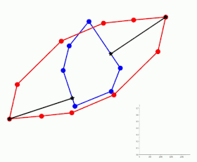

# zonopt 


A `pytorch` implementation of the results from [On Finding the Closest Zonotope to a Polytope in Hausdorff Distance](https://arxiv.org/abs/2407.13125)

<p align="center">
  
</p>

## Installation

Using poetry:
```bash
poetry install
```

Using pip:
```
pip install .
```

## Quickstart

To use `zonopt`, you will need a polytope `P` that you want to approximate by a zonotope. Instantiate `P` by specifying its vertices, for example:

```python
>>> from zonopt import Polytope
>>> P = Polytope(points=[[0,0],[1,0],[0,1],[1,1]])
```

To perform optimization, instantiate a `ZonotopeTrainer`. This requires an `Optimizer`, which specifies the learning rate and learning rate schedule, and a starting zonotope rank.

```python
>>> from zonopt.train import ZonotopeTrainer, Optimizer
>>> optim = Optimizer(lr=0.001)
>>> trainer = ZonotopeTrainer(target_polytope=P, optimizer=optim, zonotope_rank=4)
```

The `zonotope_rank` specifies the rank of the zonotopes you are searching. In this case, it will start from a random zonotope with that given rank. You can also pass your own starting zonotope `Z` to the trainer using `start=Z` instead of passing the rank (see below how to initialize a zonotope `Z`). 

To train, call the `train()` method with the desired number of steps:

```python
>>> trainer.train(500)
```

This will run subgradient descent for 500 steps and return the resulting zonotope.


## Using `zonopt`

Here we provide some documentation on how to interact with some of the objects in this package. This documentation is not complete, so if anything is unclear please submit an issue and I can address it.

### Polytopes and Zonotopes

The main geometric objects in this package are Zonotopes and Polytopes. Since all zonotopes are polytopes, the `Zonotope` class inherits from the `Polytope` class and has the same interfaces (plus a few more). A `Polytope` must be instantiated using its V-representation (vertices). Currently H-representations are not supported. A `Zonotope` is instantiated using its generators and translation.

```python
from zonopt import Polytope, Zonotope
P = Polytope(points=[[0, 0], [2, 0], [1, 2]])
Z = Zonotope(generators=[[1,0],[0,1]], translation=[0,0])
```

Both have a `.random()` method that allows you generate a random instance:
```python
P = Polytope.random(num_points=10, dimension=2) # Convex hull of 10 random 2d points
Z = Zonotope.random(rank=4,dimension=2) # Rank 4 zonotope in 2d with random generators
```

### Hausdorff distance

To compute the L2 hausdorff between two `Polytope` objects, use `hausdorff_distance`:
```python
from zonopt import hausdorff_distance
distance, _, _ = hausdorff_distance(P,Z)
```
This computation solves a quadratic program using the [qpsolvers](http://github.com/qpsolvers/qpsolvers) package. For details, see their documentation.

## Training

As shown in the Quickstart, we formulate the optimization of the hausdorff distance between a polytope `P` and a zonotope `Z` in the language of a `pytorch` training algorithm. 

Optimization works in any ambient dimension. Two equivalent losses are implemented in `zonopt/train/loss.py`: `hausdorff_loss_hyperplane`, which follows the paper's construction through supporting hyperplanes and generator determinants (with a Gram matrix correction needed in codimension at least 2), and `hausdorff_loss`, a later simplification that pulls the distance minimization back to the unit cube and differentiates `||Q^T eps + mu - p||` with the lift `eps` of `q` held fixed. The trainer uses the latter.

The vertices and facets of a zonotope are enumerated combinatorially from its generators (one pair of facets per `d-1` generators), so the cost per step grows like `C(n, d-1) 2^(d-1)` in the rank `n` rather than `2^n`. The distance from a point to a zonotope is computed as a bounded least squares problem in the unit cube coordinates, and the Hausdorff distance only solves projection problems for vertices that can achieve the maximum (cheap facet and vertex bounds rule out the rest).
